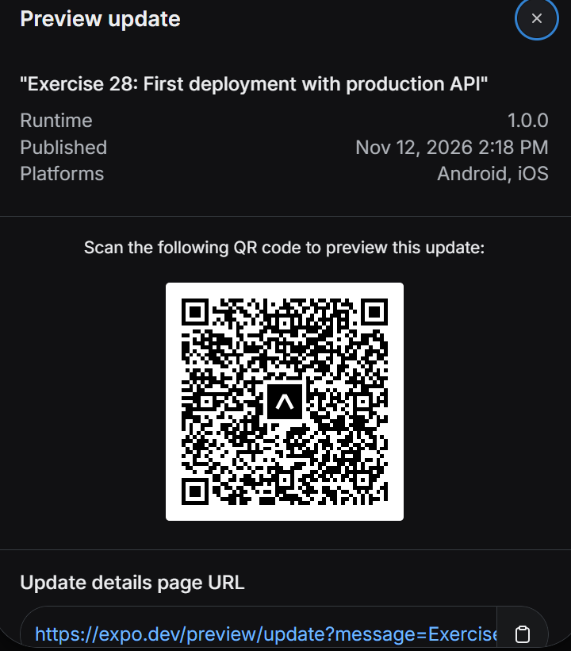

# Rate Repository App

A React Native Expo application for managing software repositories and user reviews.

## 🚀 Try the App with Expo Go

Scan this QR code with the Expo Go app to test the application:



**Note**: You'll need to:
1. Install [Expo Go](https://expo.dev/client) on your device
2. Scan the QR code above
3. The app will load with the production backend

### Testing Credentials
You can create a new account or use existing test credentials from the backend.

## Overview

The Rate Repository App allows users to:
- Sign up and sign in to the platform
- Browse software repositories with search, filtering, and pagination
- View detailed repository information including ratings and reviews
- Submit reviews and ratings for repositories
- View their own submitted reviews

## Tech Stack

- **Framework**: React Native with Expo (v57)
- **Navigation**: react-router-native
- **State Management**: Apollo Client with GraphQL
- **Forms**: Formik with Yup validation
- **Storage**: @react-native-async-storage/async-storage
- **Date Handling**: date-fns
- **Debouncing**: use-debounce

## Prerequisites

- Node.js (>= 18)
- npm or yarn
- Expo CLI
- Either Android Studio (for Android) or Xcode (for iOS) for native builds

## Environment Variables

Create a `.env` file in the root directory with the following variable:

```
EXPO_PUBLIC_APOLLO_URI=your_graphql_endpoint_url
```

The `.env` file already exists in the project root.

## Installation

```bash
npm install
```

or

```bash
yarn install
```

## Available Scripts

| Script | Description |
|--------|-------------|
| `npm start` or `expo start` | Start the Expo development server |
| `npm android` | Run the app on Android |
| `npm ios` | Run the app on iOS |
| `npm web` | Run the app in a web browser |
| `npm lint` | Run the linter (expo lint) |
| `npm test` | Run tests with Jest |

## Project Structure

```
src/
  contexts/        # React contexts (AuthStorageContext)
  components/      # UI components
    AppBar.jsx     # Application header
    FormField.jsx  # Form input field
    Main.jsx       # Main router container
    MyReviews.jsx  # User's reviews
    RepositoryItem.jsx  # Repository list item
    RepositoryList.jsx  # Repository list view
    ReviewForm.jsx # Review submission form
    ReviewItem.jsx # Review display component
    SignIn.jsx     # Sign in screen
    SignUp.jsx     # Sign up screen
    SingleRepository.jsx  # Single repository detail view
    Text.jsx       # Text styling component
  utils/           # Utility functions
    apolloClient.js  # Apollo Client configuration with auth link
    authStorage.js   # Authentication token storage via AsyncStorage
    format.js        # Date/formatting utilities
  graphql/         # GraphQL queries, mutations, and fragments
    queries.js       # GraphQL queries
    mutations.js     # GraphQL mutations
    fragments.js     # GraphQL fragments
App.js               # Root component with Apollo provider and auth context
index.js             # Entry point registering the root component
theme.js             # Application theming/colors
```

## Key Features

- **Authentication**: JWT-based authentication stored in AsyncStorage
- **Repository Browsing**: Paginated list with search and order filtering
- **Repository Details**: View single repository with all reviews
- **Review System**: Submit and manage reviews with ratings
- **Protected Routes**: Authentication required for review-related actions

## Development

```bash
# Start development server
npm start

# Run tests
npm test

# Lint code
npm lint
```

## Building for Production

- **Android**: `expo build:android`
- **iOS**: `expo build:ios`
- **Web**: `expo build:web`